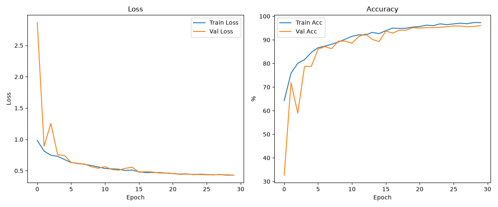
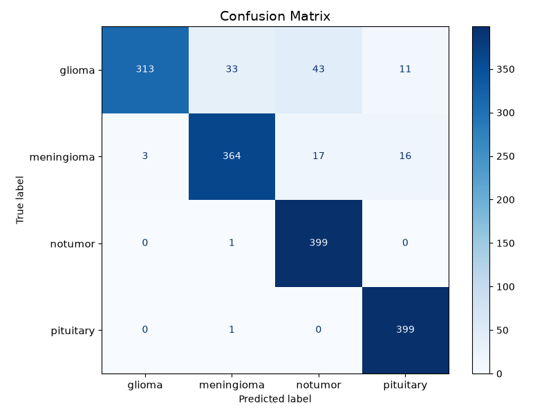
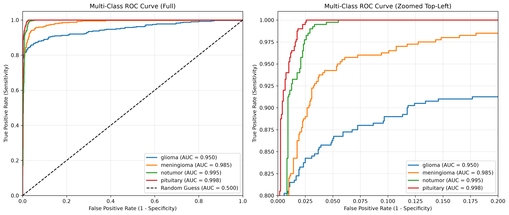
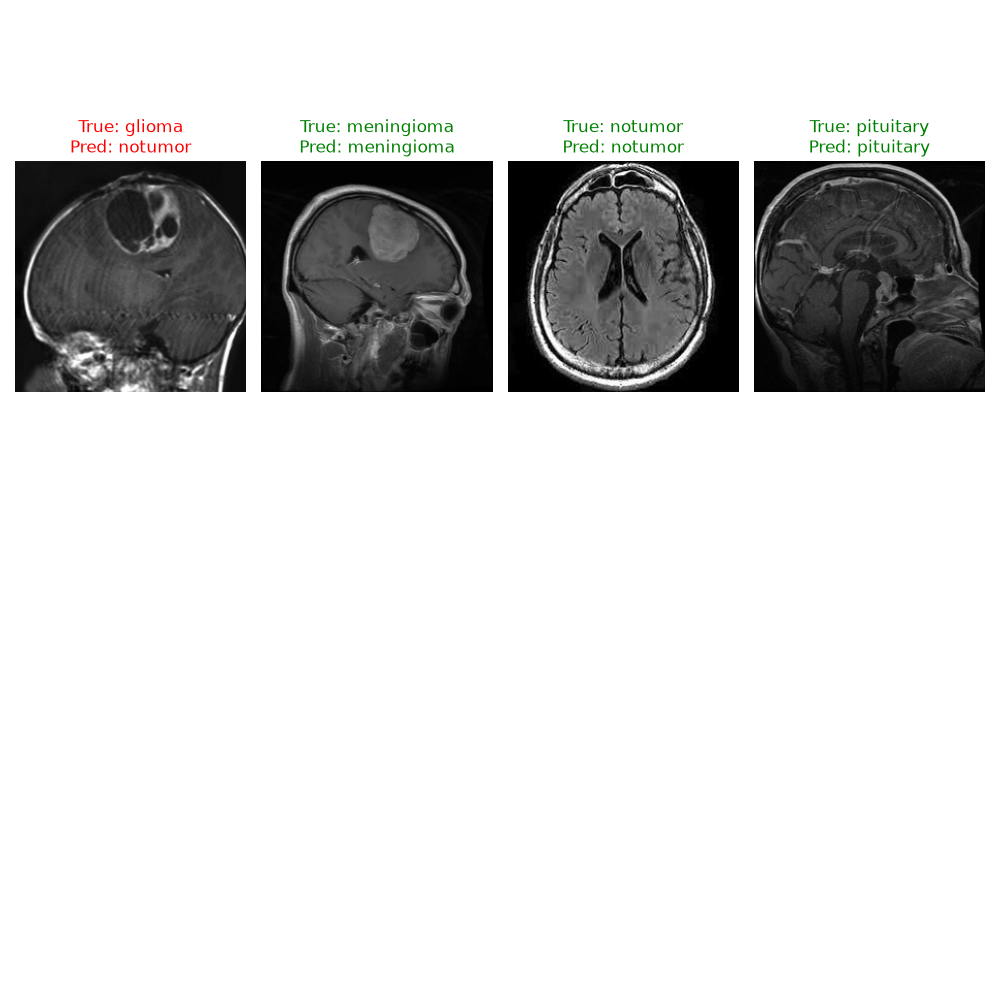

# 🧠 Brain Tumor MRI Classification

A supervised deep learning project that classifies brain MRI scans into four categories using a custom CNN built from scratch in PyTorch.

---

## 📌 Classes

| Label | Description |
|-------|-------------|
| Glioma | Malignant tumor originating in glial cells |
| Meningioma | Tumor arising from the meninges |
| No Tumor | Healthy brain scan |
| Pituitary | Tumor in the pituitary gland |

---

## 📁 Project Structure

```
Brain-Tumor-Detection/
│
├── app/
│   ├── app.py              # Main runner script
│   └── utils.py            # Training curve plotting
│
├── config/                 # Configuration files
│
├── dataset/
│   ├── preprocessed/
│   │   ├── Training/       # 5600 images (1400 per class)
│   │   └── Testing/        # 1600 images (400 per class)
│   └── raw/
│
├── models/
│   └── checkpoints/
│       └── best_model.pth
│
├── notebooks/
│   ├── 01_data_exploration.ipynb
│   ├── 02_data_preprocessing.ipynb
│   ├── 03_model_building.ipynb
│   ├── 04_model_training.ipynb
│   └── 05_model_evaluation.ipynb
│
├── outputs/
│   ├── plots/
│   │   ├── confusion_matrix.png
│   │   ├── model_training.png
│   │   └── roc_curve_comparison.png
│   └── predictions/
│       └── predictions.png
│
├── src/
│   ├── __init__.py
│   ├── data_loader.py      # Dataset class + transforms + DataLoaders
│   ├── evaluate.py         # Evaluation, confusion matrix, ROC curve
│   ├── model.py            # CNN architecture
│   ├── predict.py          # Prediction visualization
│   ├── preprocessing.py    # Mean/std computation
│   └── train.py            # Training loop + early stopping
│
├── .gitignore
├── README.md
└── requirements.txt
```

---

## 🧠 Model Architecture

Custom CNN trained from scratch — no pretrained weights.

- **5 convolutional blocks** — each with double Conv2d → BatchNorm → ReLU → MaxPool
- **Filter progression:** 1 → 32 → 64 → 128 → 256 → 512
- **AdaptiveAvgPool2d** — reduces spatial dimensions to 1×1
- **Classifier:** 512 → 256 → 128 → 4 with Dropout regularization
- **Total parameters:** ~4.87M

---

## ⚙️ Training Configuration

| Setting | Value |
|---------|-------|
| Input size | 224×224 grayscale |
| Batch size | 64 |
| Optimizer | Adam (lr=0.001) |
| Scheduler | StepLR (step=5, γ=0.5) |
| Loss | CrossEntropyLoss (label_smoothing=0.1) |
| Epochs | 30 |
| Early stopping | patience=7, min_delta=0.001 |
| Val split | 10% of training data |

### Augmentation (train only)
- RandomHorizontalFlip
- RandomRotation(10°)
- RandomAffine(translate=0.05, scale=0.95–1.05)
- ColorJitter(brightness=0.1, contrast=0.1)

---

## 📊 Results

### Test Set Performance

| Metric | Value |
|--------|-------|
| Test Accuracy | 92.19% |
| Glioma Recall | 78.25% |
| Meningioma Recall | 91.00% |
| Notumor Recall | 99.75% |
| Pituitary Recall | 99.75% |

### Training Curves



### Confusion Matrix



### ROC Curves

| Class | AUC |
|-------|-----|
| Glioma | 0.950 |
| Meningioma | 0.985 |
| No Tumor | 0.995 |
| Pituitary | 0.998 |



### Sample Predictions



---

## 🚀 Getting Started

### 1. Clone the repository
```bash
git clone https://github.com/yourusername/Brain-Tumor-Detection.git
cd Brain-Tumor-Detection
```

### 2. Create virtual environment
```bash
python -m venv .venv
.venv\Scripts\activate  # Windows
source .venv/bin/activate  # Linux/Mac
```

### 3. Install dependencies
```bash
pip install -r requirements.txt
```

### 4. Download dataset
Download from [Kaggle](https://www.kaggle.com/datasets/masoudnickparvar/brain-tumor-mri-dataset) and place under `dataset/preprocessed/`.

### 5. Run
```bash
python app/app.py
```

---

## 🔍 Key Observations

- **Notumor and Pituitary** are essentially solved — 99.75% recall on both
- **Glioma** is the hardest class — visual overlap with other tumor types causes 22% misclassification
- **Glioma→Notumor** confusion is the most clinically dangerous error — the model classifies actual tumors as healthy
- Transfer learning with EfficientNetB0 is the natural next step to push glioma recall above 90%

---

## 🛠️ Built With

- Python 3.13
- PyTorch
- torchvision
- scikit-learn
- matplotlib
- Pillow
- NumPy

---

## 📄 License

MIT License